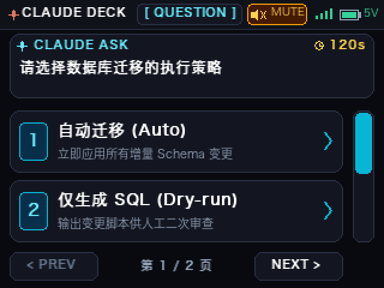
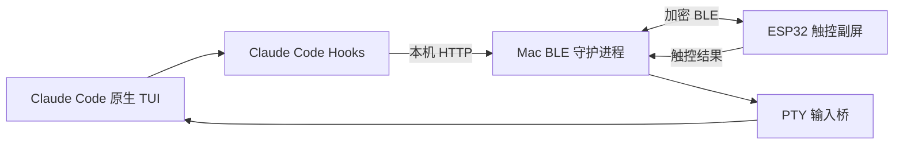

<div align="center">

# Claude Deck

**把 ESP32 触控屏变成 Claude Code 的实体交互副屏**

[](LICENSE)
[](firmware)
[](host)

</div>

Claude Deck 使用一块常见的 **ESP32-2432S028（2.8 英寸 CYD 小黄板）**，通过蓝牙与 Mac 上的 Claude Code 通信。Claude 需要用户选择、确认权限或报告运行状态时，副屏会显示对应卡片；用户可以在终端或副屏完成交互。



## 可以做什么

- **同步 Claude 提问**：支持 `AskUserQuestion` 单选、多选和多题表单。
- **实体权限审批**：Claude Code 发出原生权限请求时，可在副屏允许或拒绝。
- **双端交互**：同一个问题保留在 Claude 原生 TUI，同时也显示在副屏；任一端先完成即可继续。
- **完整信息审阅**：长命令可翻页；不适合副屏显示的内容回退到终端。
- **状态提醒**：显示待命、思考、审批、通过、拒绝和超时状态，并提供 RGB 灯与提示音。
- **日常体验**：支持一键静音、60 秒自动降亮、触摸唤醒和防误触。
- **安全回退**：蓝牙离线或等待超时时默认拒绝需要实体审批的操作。

## 实现方法与设计逻辑



项目分为三层：

1. **Claude 接入层**：Hook 捕获结构化问题和权限事件；`deck-code` 使用透明 PTY 启动原版 Claude Code，因此欢迎页、输入框、插件和斜杠命令仍是原生体验。
2. **Mac 桥接层**：守护进程只监听 `127.0.0.1:19842`，负责蓝牙连接、消息排队、超时和触控结果回传。
3. **ESP32 交互层**：固件负责屏幕、触摸、提示音、状态灯和 UI 状态机，不保存 Claude 会话内容。

设计上遵循以下原则：

- 终端和副屏共享同一个交互，谁先完成谁生效。
- 权限请求必须展示足够的信息；内容过长时交给终端处理。
- 断线、超时和无效数据采用故障安全策略。
- CCSwitch、模型配置、插件、`CLAUDE.md` 和项目设置继续由原版 Claude Code 管理。

更完整的技术说明见 [架构文档](docs/ARCHITECTURE.md)。

## 准备工作

### 硬件

- ESP32-2432S028 / CYD 2.8 英寸触控开发板
- 一根可以传输数据的 USB 线
- 一台支持蓝牙的 Mac

当前主机端使用 macOS CoreBluetooth，Windows 和 Linux 尚未提供安装脚本。

### 软件

- 已经可以正常运行的 Claude Code CLI
- [Homebrew](https://brew.sh/)
- `uv` 和 PlatformIO

```bash
brew install uv platformio
```

## 安装与部署

### 1. 下载项目

```bash
git clone https://github.com/leilintao/claude-deck.git
cd claude-deck
```

### 2. 编译并烧录副屏

连接开发板后，先查看串口名称：

```bash
cd firmware
pio device list
```

找到类似 `/dev/cu.usbserial-1120` 的设备，然后烧录：

```bash
pio run -t upload --upload-port /dev/cu.usbserial-1120
cd ..
```

请把命令中的串口替换成自己电脑显示的名称。烧录完成后，副屏会自动重启。

### 3. 首次蓝牙配对

```bash
uv run --with bleak python3 host/enroll_deck.py
```

按终端提示选择 `Claude-Deck`。Mac 出现配对窗口时，输入副屏显示的六位数字；确认副屏显示 `ONLINE` 后，在终端输入 `yes`。

macOS 第一次运行时可能询问蓝牙权限，请允许当前终端或 Python 使用蓝牙。

### 4. 安装后台服务

```bash
./host/install_service.sh
```

该脚本会把蓝牙守护进程注册为当前用户的 macOS 后台服务。日志位于：

```text
~/Library/Logs/claude_deck.log
```

如需卸载：

```bash
./host/uninstall_service.sh
```

### 5. 安装 Claude Code Hook

```bash
python3 host/configure_native_tui.py
```

脚本会保留现有 Claude Code 配置，并在首次运行时备份为：

```text
~/.claude/settings.json.deck-backup
```

### 6. 启动 Claude Code

在需要工作的项目目录中运行：

```bash
/你下载项目的位置/claude-deck/host/deck-code --cwd "$PWD"
```

例如仓库位于 `~/claude-deck`：

```bash
~/claude-deck/host/deck-code --cwd "$PWD"
```

`deck-code` 默认加入 `--dangerously-skip-permissions`，适合主要使用副屏回答 Claude 问题的用户。此模式下 Claude 不会产生原生权限请求，因此副屏也不会显示权限审批卡。

如需同时测试或使用实体权限审批，请运行：

```bash
~/claude-deck/host/deck-code --no-bypass-permissions --cwd "$PWD"
```

`deck-code` 最终仍调用电脑上的原版 `claude` 命令，因此可以继续使用 CCSwitch。

## 使用方法

- **单选问题**：直接点击副屏选项。
- **多选问题**：勾选一个或多个选项，再点击 `SUBMIT`。
- **长内容**：点击中央内容框翻到下一页。
- **权限请求**：核对命令或文件内容后点击“允许”或“拒绝”。
- **静音**：点击右上角 `SND/MUTE`，或待命页底部的音频按钮。
- **终端作答**：Claude 原生问题卡仍可正常操作，终端先提交后副屏卡片会失效。

只有 Claude 实际调用 `AskUserQuestion` 时，问题才能成为可同步的交互卡。Claude 直接输出在聊天正文里的普通问句无法被可靠地转换成副屏按钮。

## 交给 AI 自动安装

可以把下面这段话连同项目路径交给本地编码 AI：

> 请部署当前 Claude Deck 项目。先确认系统是 macOS，并检查 `claude`、`uv`、`pio` 是否存在；不要覆盖已有的 `~/.claude/settings.json`。使用 `pio device list` 识别 ESP32 串口，编译并烧录 `firmware`。烧录成功后暂停，让我亲自完成六位数蓝牙配对和副屏确认。然后运行 `host/install_service.sh` 与 `host/configure_native_tui.py`，检查后台日志确认副屏 ONLINE，运行自动化测试，最后告诉我 `deck-code` 的绝对启动命令。不要替我猜测串口、配对码或实体触控结果。

AI 部署时可按以下验收顺序执行：

```bash
claude --version
uv --version
pio --version
pio device list
pio run -d firmware
launchctl list | grep claude.deck
tail -n 30 ~/Library/Logs/claude_deck.log
uv run --with bleak --with pygame-ce python3 -m unittest discover -s tests -q
```

## 常见问题

### 副屏没有显示问题

检查后台服务和连接日志：

```bash
launchctl list | grep claude.deck
tail -f ~/Library/Logs/claude_deck.log
```

确认副屏显示 `ONLINE`，并使用 `deck-code` 启动 Claude。普通文本问题不会触发副屏，必须是 `AskUserQuestion` 事件。

### 找不到开发板串口

确认 USB 线支持数据传输，重新插拔后再次运行 `pio device list`。常见名称包含 `usbserial`、`usbmodem`、`wch` 或 `SLAB`。

### 配对后仍然离线

打开 macOS 蓝牙，确认终端拥有蓝牙权限，然后重启服务：

```bash
./host/install_service.sh
```

### 想先看看界面，不连接硬件

```bash
./host/run_simulator.sh
```

## 项目目录

```text
firmware/    ESP32 固件与 PlatformIO 配置
host/        Mac 守护进程、Hook、原生 TUI 桥和模拟器
tests/       主机端自动化测试
docs/        架构与实现说明
screenshots/ HMI 截图
```

## License

[MIT](LICENSE)
