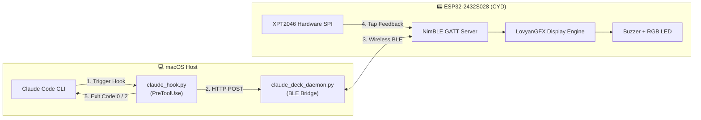

<div align="center">

# 🤖 Claude Deck
### A Wireless Bluetooth Touch Companion & Physical Approval Deck for Claude Code
**基于 ESP32-2432S028 (CYD / 小黄板) 的 Claude Code 物理副屏交互终端**

[](LICENSE)
[](https://platformio.org/)
[]()
[](https://claude.ai/code)

</div>

---

## 🌟 概述 / Overview

**Claude Deck** 将百元级的开源小黄板开发板（**ESP32-2432S028**）打造为 **Claude Code** 的桌面实体“副驾驶”终端。

当 Claude Code 在终端执行任何高危工具调用（如执行 Bash 脚本、运行终端命令或修改关键代码）时：
1. **无线广播**：Mac 端的轻量守护进程通过 **BLE 蓝牙** 无线推送待确认事件；
2. **多感官提醒**：副屏自动点亮卡片详情、蜂鸣器发出提示音、板载 RGB LED 亮起黄色警示；
3. **触控交互**：直接在副屏上用触控笔或手指轻触 **`[ 允许 (Y) ]`** 或 **`[ 拒绝 (N) ]`**；
4. **即时放行/拦截**：终端无缝获得物理应答并继续工作，极大地提升了 AI 结对编程的安全感与极客桌面氛围！

---

## 📐 系统架构 / Architecture



---

## 🛠️ 硬件引脚定义 / Pinout (ESP32-2432S028 / HW-458)

| 模块类别 | 硬件型号与特性 | GPIO 管脚分配 |
| :--- | :--- | :--- |
| **主控芯片** | ESP-WROOM-32 (240MHz 双核, 520KB SRAM) | 板载 PCB 天线 (2dBi) |
| **显示屏幕** | 2.8 英寸 TFT 320×240 (ILI9341 / ST7789) | MOSI:13, MISO:12, SCLK:14, CS:15, DC:2 |
| **屏幕背光** | 硬件直通高电平供电 (BL) | **GPIO 21** & **GPIO 27** (HIGH) |
| **电阻触摸** | XPT2046 独立硬件 VSPI 总线 | CLK:25, MISO:39, MOSI:32, CS:33, IRQ:36 |
| **状态指示** | 板载三色 RGB LED (Active LOW) | R:4, G:16, B:17 |
| **音频提醒** | 板载微型功放 (SPEAKER 插座) | **GPIO 26** |

---

## 📂 项目结构 / Repository Layout

```text
.
├── firmware/                     # ESP32 固件源码 (PlatformIO 工程)
│   ├── platformio.ini           # 编译参数与库依赖配置
│   └── src/
│       └── main.cpp             # 固件源码 (LovyanGFX + XPT2046 + NimBLE)
├── host/                         # Mac 端中继与 Claude Code 钩子
│   ├── claude_deck_daemon.py    # BLE 守护进程 (监听 127.0.0.1:19842)
│   ├── claude_hook.py           # Claude Code PreToolUse 钩子脚本
│   ├── start_deck.sh            # 前台一键启动脚本
│   ├── install_service.sh       # 注册为 macOS 后台开机自启服务 (launchd)
│   └── uninstall_service.sh     # 卸载后台服务
├── LICENSE                       # MIT 开源协议
└── README.md
```

---

## 🚀 快速上手 / Quick Start

### 步骤 1：烧录固件到开发板

确保你的电脑已安装 [PlatformIO](https://platformio.org/)（可通过 `pip install platformio` 或 `uv tool install platformio` 安装）：

```bash
# 1. 克隆本仓库
git clone https://github.com/leilintao/claude-deck.git
cd claude-deck/firmware

# 2. 将 ESP32 通过 Type-C 数据线连接至电脑
# 3. 编译并烧录
pio run -t upload
```

> **烧录成功后**：屏幕背光点亮，并显示深色卡片界面的 `CLAUDE DECK`，板载黄色指示灯亮起。

---

### 步骤 2：启动 Mac 端蓝牙守护进程

推荐使用 `uv` 运行 Python 脚本（无需手动配置 Python 虚拟环境）：

```bash
cd ../host

# 方式 A：前台运行（可查看实时蓝牙交互日志）
./start_deck.sh

# 方式 B：注册为 macOS 开机后台自启服务
./install_service.sh
```

---

### 步骤 3：配置 Claude Code 钩子

在你的 Claude Code 全局配置文件 `~/.claude/settings.json` 中添加 `PreToolUse` 拦截配置：

```json
{
  "hooks": {
    "PreToolUse": [
      {
        "matcher": "",
        "hooks": [
          {
            "type": "command",
            "command": "/你的绝对路径/claude-deck/host/claude_hook.py"
          }
        ]
      }
    ]
  }
}
```

---

## 🎯 效果演示与交互体验

1. 打开任何工程目录运行 `claude`；
2. 当 Claude 请求执行 `git push`、`npm test` 或写入敏感文件时：
   - 屏幕立即 **“哔”** 一声短响；
   - 居中显示待执行命令或文件路径详情；
   - 底部亮起绿色 `[ 允许 (Y) ]` 与红色 `[ 拒绝 (N) ]` 两个大按钮；
3. 用触控笔或手指轻触对应按钮：
   - 点 **`[ 允许 (Y) ]`** ➡️ 发送放行信号（退出码 0），终端命令瞬间继续执行；
   - 点 **`[ 拒绝 (N) ]`** ➡️ 发送拒绝信号（退出码 2），Claude 收到拒绝原因并终止高危操作。
4. **安全回退机制**：如果副屏未开机或蓝牙未连接，默认按 `CLAUDE_DECK_OFFLINE_POLICY=deny` 拒绝高危操作；如需可用性优先，可显式设置该环境变量为 `allow`。

---

## 🤝 贡献与感谢 / Contributions & Credits

- [LovyanGFX](https://github.com/lovyan03/LovyanGFX) — 卓越的跨平台图形引擎
- [NimBLE-Arduino](https://github.com/h2zero/NimBLE-Arduino) — 轻量级低功耗蓝牙协议栈
- [XPT2046_Touchscreen](https://github.com/PaulStoffregen/XPT2046_Touchscreen) — 经典的触控屏驱动
- [ESP32 Cheap Yellow Display](https://github.com/witnessmenow/ESP32-Cheap-Yellow-Display) — CYD 社区开拓者

欢迎提交 Issue 和 Pull Request！

---

## 📄 开源许可证 / License

本项目采用 [MIT License](LICENSE) 开源协议。
