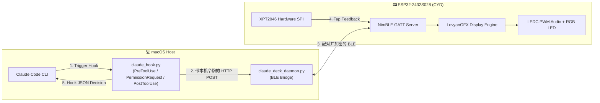

<div align="center">

# 🤖 Claude Deck
### A Wireless Bluetooth Touch Companion & Physical Approval Deck for Claude Code
**基于 ESP32-2432S028 (CYD / 小黄板) 的 Claude Code 物理副屏交互终端**

[](LICENSE)
[](https://platformio.org/)
[]()
[](https://claude.ai/code)

</div>

---

## 🌟 概述 / Overview

**Claude Deck** 将百元级的开源小黄板开发板（**ESP32-2432S028**）打造为 **Claude Code** 的桌面实体“副驾驶”终端。

当 Claude Code 在终端执行工具调用或请求高危权限（如执行 Bash 脚本、运行终端命令或修改关键代码）时：
1. **安全配对**：首次使用时将 Mac 与副屏绑定；之后 Mac 端守护进程通过加密 BLE 连接推送待确认事件与执行状态；
2. **多感官分级提醒**：副屏自动点亮卡片详情、硬件 `LEDC` PWM 蜂鸣器发出多音阶语义提示音（支持一键静音）、板载 RGB LED 随状态变色（待命绿 / 思考蓝 / 审批黄 / 拦截红）；
3. **触控交互与长命令翻页**：可点击代码框翻页查看副屏可容纳的完整操作详情；超出容量的请求转到终端完整审批；
4. **即时放行/拦截与双端同步**：终端无缝获得物理应答并继续工作；若在 Mac 键盘直接确认，`PostToolUse` 钩子会自动通知副屏消警归位！

---

## 📐 系统架构 / Architecture



---

## 🛠️ 硬件引脚定义 / Pinout (ESP32-2432S028 / HW-458)

| 模块类别 | 硬件型号与特性 | GPIO 管脚分配 |
| :--- | :--- | :--- |
| **主控芯片** | ESP-WROOM-32 (240MHz 双核, 520KB SRAM) | 板载 PCB 天线 (2dBi) |
| **显示屏幕** | 2.8 英寸 TFT 320×240 (ILI9341 / ST7789) | MOSI:13, MISO:12, SCLK:14, CS:15, DC:2 |
| **屏幕背光** | 硬件 `LEDC` PWM 自动调光与闲置休眠 (BL) | **GPIO 21** & **GPIO 27** (PWM Channel 0) |
| **电阻触摸** | XPT2046 独立硬件 VSPI 总线 (带压力过滤与释放锁) | CLK:25, MISO:39, MOSI:32, CS:33, IRQ:36 |
| **状态指示** | 板载三色 RGB LED (Active LOW) | R:4, G:16, B:17 |
| **音频提醒** | 板载微型功放 (`LEDC` PWM 多音阶提示音) | **GPIO 26** (PWM Channel 1) |

---

## 📂 项目结构 / Repository Layout

```text
.
├── firmware/                     # ESP32 固件源码 (PlatformIO 工程)
│   ├── platformio.ini           # 编译参数与库依赖配置
│   └── src/
│       └── main.cpp             # 固件源码 (LovyanGFX + XPT2046 + NimBLE)
├── host/                         # Mac 端中继、仿真器与 Claude Code 钩子
│   ├── claude_deck_daemon.py    # BLE 守护进程 (监听 127.0.0.1:19842)
│   ├── claude_hook.py           # Claude Code 全生命周期钩子脚本
│   ├── virtual_deck.py          # 桌面原生 320x240 交互仿真器 (监听 127.0.0.1:19843)
│   ├── test_ble.py              # BLE 物理真机联调测试脚本
│   ├── start_deck.sh            # 前台一键启动脚本
│   ├── run_simulator.sh         # 启动桌面原生交互仿真器
│   ├── install_service.sh       # 注册为 macOS 后台开机自启服务 (launchd)
│   └── uninstall_service.sh     # 卸载后台服务
├── tests/                        # 自动化测试套件
│   └── test_hmi_simulator.py    # HMI 视觉规范、热区边界与安全白名单单测
├── docs/                         # 架构设计文档
│   └── ARCHITECTURE.md          # 软硬件架构与踩坑复盘
├── LICENSE                       # MIT 开源协议
└── README.md
```

---

## 🚀 快速上手 / Quick Start

### 步骤 1：烧录固件到开发板

确保你的电脑已安装 [PlatformIO](https://platformio.org/)（可通过 `pip install platformio` 或 `uv tool install platformio` 安装）：

```bash
# 1. 进入固件工程目录
cd firmware

# 2. 将 ESP32 通过 Type-C 数据线连接至电脑，编译并烧录
pio run -t upload
```

> **烧录成功后**：屏幕背光点亮，显示深色机甲风 `CLAUDE DECK` 待命大盘，板载绿色指示灯亮起。闲置 60 秒后背光会自动柔化降亮。

---

### 步骤 2：首次绑定副屏

固件烧录完成后，运行绑定程序。Mac 弹出蓝牙配对窗口时，输入**实体副屏屏幕上显示**的六位数字；程序会将所选设备的 CoreBluetooth 标识保存在当前用户的 `~/.config/claude-deck/device-id` 中。固件只接受首次成功绑定的主机。更换 Mac 时需清除开发板的 NVS 后重新绑定。

```bash
cd .. # 若刚完成上一步的 firmware 目录操作，先回到仓库根目录
uv run --with bleak python3 host/enroll_deck.py
```

### 步骤 3：启动 Mac 端蓝牙守护进程

推荐使用 `uv` 运行 Python 脚本（无需手动配置 Python 虚拟环境）：

```bash
cd host

# 方式 A：前台运行（可查看实时蓝牙交互日志）
./start_deck.sh

# 方式 B：注册为 macOS 开机后台自启服务
./install_service.sh
```

---

### 步骤 4：配置 Claude Code 钩子

在你的 Claude Code 全局配置文件 `~/.claude/settings.json` 中添加 `PreToolUse`、`PermissionRequest` 与 `PostToolUse` 钩子配置：

```json
{
  "hooks": {
    "PreToolUse": [
      {
        "matcher": "",
        "hooks": [
          {
            "type": "command",
            "command": "/你的绝对路径/ESP/host/claude_hook.py"
          }
        ]
      }
    ],
    "PermissionRequest": [
      {
        "matcher": "",
        "hooks": [
          {
            "type": "command",
            "command": "/你的绝对路径/ESP/host/claude_hook.py"
          }
        ]
      }
    ],
    "PostToolUse": [
      {
        "matcher": "",
        "hooks": [
          {
            "type": "command",
            "command": "/你的绝对路径/ESP/host/claude_hook.py"
          }
        ]
      }
    ]
  }
}
```

> **可选环境变量**：
> - `CLAUDE_DECK_OFFLINE_POLICY=deny|allow`：副屏离线时的回退策略（默认 `deny` 故障安全拦截）。
> - `CLAUDE_DECK_INTERCEPT_MODE=pre_tool_use|notify_only`：默认 `pre_tool_use`，在每次非只读工具调用前等待实体审批。`notify_only` 仅展示状态，权限仍由 Claude Code 原生流程决定。
> - `CLAUDE_DECK_TIMEOUT=120`：审批与提问的超时熔断秒数（默认 `120` 秒）。

> 守护进程和 Hook 自动共用权限为 `0600` 的本机 IPC 令牌。首次绑定与使用后台服务时，应以同一个 macOS 用户运行。安全只读 Bash 规则只自动放行受限参数；其他命令走审批。

---

## 🎯 效果演示与交互体验

1. **高危权限双键把关**：
   - 当 Claude 请求执行高危命令或修改文件时，副屏发出双音阶提醒，顶部显示工具徽章（如 `[BASH EXEC]`）与风险等级（`HIGH RISK` / `CRITICAL`），底部动态倒计时 `⚡ 120s 超时熔断`；
   - 如果详情超过 3 行，代码框右下角会出现 `[▾ 1/2]` 标记，轻触代码框可逐页审阅；超过副屏容量时，将在终端展示完整请求供审批；
   - 点 **`[ 允许 (Y) ]`** ➡️ 亮绿灯并展示绿色 `APPROVED` 放行页，2.5 秒后自动归位待命页；
   - 点 **`[ 拒绝 (N) ]`** ➡️ 亮红灯并展示红色 `STOPPED` 拦截页，Claude 收到拒绝原因并中止高危操作。
2. **Claude 提问页（`AskUserQuestion`）**：
   - 副屏显示问题与选项卡片，超过两个选项自动开启右侧滑动条与底部 `◀ PREV` / `NEXT ▶` 分页；用户点选后结果直接回传给 Claude Code 继续执行。
3. **一键静音与夜间自动调光**：
   - 在待命页点击底部中间的 **`AUDIO TAP`** 卡片（或状态栏右上角 `SND/MUTE`）即可随时开启/关闭蜂鸣器提示音；
   - 待命闲置 60 秒后屏幕自动降至 14% 柔和背光并熄灭 RGB 灯，收到新消息或轻触屏幕即刻唤醒。

---

## 🤝 贡献与感谢 / Contributions & Credits

- [LovyanGFX](https://github.com/lovyan03/LovyanGFX) — 卓越的跨平台图形引擎
- [NimBLE-Arduino](https://github.com/h2zero/NimBLE-Arduino) — 轻量级低功耗蓝牙协议栈
- [XPT2046_Touchscreen](https://github.com/PaulStoffregen/XPT2046_Touchscreen) — 经典的触控屏驱动
- [ESP32 Cheap Yellow Display](https://github.com/witnessmenow/ESP32-Cheap-Yellow-Display) — CYD 社区开拓者

---

## 📄 开源许可证 / License

本项目采用 [MIT License](LICENSE) 开源协议。
