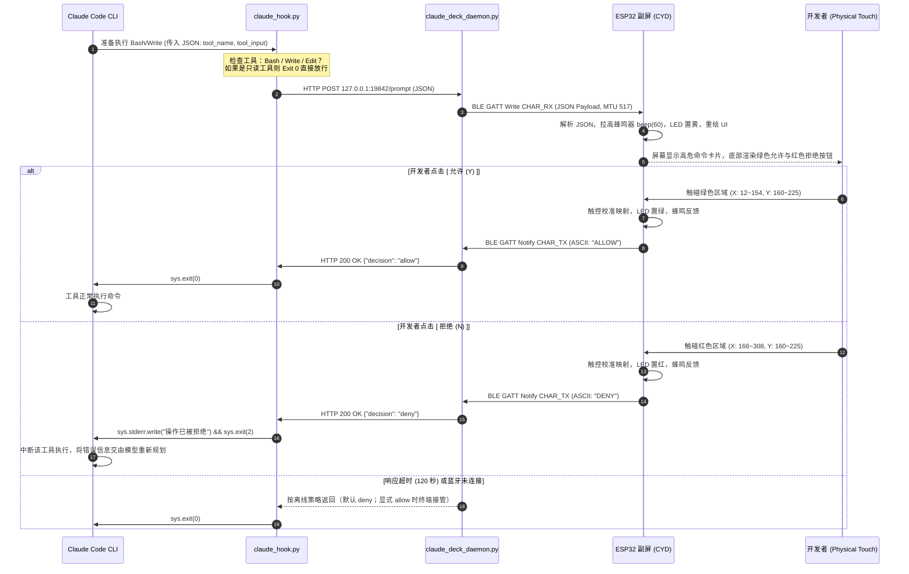

# Claude Deck：基于 ESP32-2432S028 的 Claude Code 物理副屏开发与系统架构全解析

> **开源项目地址**：[https://github.com/leilintao/claude-deck](https://github.com/leilintao/claude-deck)  
> **前置硬件参考**：[[ESP32-2432S028 硬件背景与开发指南]]  
> **系统宿主环境**：macOS (Apple Silicon / Intel, zsh)  
> **硬件终端**：ESP32-2432S028 (HW-458 / 创客黄板 CYD, 2.8寸 TFT + XPT2046 电阻触摸)

---

## 1. 项目缘起与核心价值 (Project Vision & Core Value)

### 1.1 痛点：CLI 交互时代的注意力与安全断层
随着 Anthropic **Claude Code**、OpenAI Codex、Gemini Code Assist 等下一代终端自主编程 Agent 的兴起，开发者的日常工作方式正在从“逐行写代码”转向“与 Agent 结对编程（Pair Programming）”。

然而，在日常使用 Claude Code CLI 时，普遍存在一个高频交互痛点：
- **高危工具权限打断感强**：Claude 在执行 `Bash`（如 `rm -rf`、`npm install`、`git push --force`）、`Write`、`Edit` 等破坏性或持久化写入工具时，必须在终端挂起并等待用户输入 `y/n` 确认。
- **窗口切换割裂思路**：当开发者在全屏 IDE、浏览器查阅文档或阅读长篇架构图时，终端往往隐藏在后台，容易错过 Claude 的确认提问；或者必须来回切换 Command-Tab / 触摸板滑动手势，打断了心流（Flow State）。
- **误操作风险**：在连续快速敲击键盘时，盲目敲回车极易将未审查的高危 Shell 指令放行。

### 1.2 解决方案：打造硬件物理把关台 (Claude Deck)
本项目利用百元内极具性价比的开源硬件 **ESP32-2432S028**（国内创客常称“创客黄板”，国外被称为 **CYD - Cheap Yellow Display**，整板成本仅约 35 元），构建了一台放置在电脑键盘旁的桌面无线物理确认台：

1. **无线低功耗 BLE 自动连携**：设备上电即自动与 Mac 建立低功耗蓝牙（Bluetooth LE）通道，无需插入 USB 线，可由 18650 电池扩展板独立供电。
2. **高危工具动态拦截**：通过 Claude Code 的官方 Hook 机制，精准捕获 `Bash`、`Write`、`Edit` 等操作，将其提炼为直观的卡片推送至副屏。
3. **物理触控一键审批**：在 2.8 寸彩屏上高亮渲染绿色的 **[ 允许 (Y) ]** 与红色的 **[ 拒绝 (N) ]** 大按钮。轻触即可向终端回传决定；拒绝时会将操作在终端立刻打断并向 Claude 模型反馈拒由。
4. **声光立体反馈**：集成板载 RGB 状态指示灯（待命/思考/提问/通过变色）与压电蜂鸣器（高频短音提示提问到达）。
5. **故障安全降级**：若副屏关机、蓝牙断开或未启动后台服务，默认按 `CLAUDE_DECK_OFFLINE_POLICY=deny` 拒绝高危操作；设为 `allow` 时可退回终端默认交互。

---

## 2. 系统整体架构与交互时序 (System Architecture)

整个系统由三大模块解耦组成：
1. **ESP32 嵌入式固件 (`firmware`)**：负责显示驱动、电阻触控消抖与坐标校准、BLE GATT 服务端与 UI 状态机。
2. **Mac 主机守护桥接层 (`claude_deck_daemon.py`)**：负责 CoreBluetooth BLE 连接维持、异步事件协调与本地 HTTP IPC 服务。
3. **Claude Code 接入层 (`claude_hook.py`)**：作为 Claude CLI `PreToolUse` Hook 的可执行入口，负责过滤工具类型并转换决定。

### 2.1 系统架构拓扑图

```mermaid
flowchart TD
    subgraph Claude_Environment ["Claude Code 运行环境 (Mac)"]
        CLI["Claude Code CLI (claude)"]
        Hook["claude_hook.py (PreToolUse Hook)"]
        Settings["~/.claude/settings.json"]
        CLI -->|"工具执行前触发 (STDIN JSON)"| Hook
        Settings -.->|"声明 Hook 路径"| Hook
    end

    subgraph Host_Daemon ["Mac 主机守护进程 (Python 3 / asyncio)"]
        HTTP_Server["本地 HTTP 服务 (127.0.0.1:19842)"]
        Bridge["DeckBridge 协调器"]
        Bleak["BleakClient (macOS CoreBluetooth)"]
        
        Hook -->|"POST /prompt (HTTP IPC)"| HTTP_Server
        HTTP_Server <-->|"Future / Event 同步"| Bridge
        Bridge <-->|"GATT TX / RX"| Bleak
    end

    subgraph Hardware_Device ["ESP32-2432S028 硬件副屏 (CYD)"]
        BLE_Server["NimBLE GATT Server"]
        StateMachine["UI 状态机 (IDLE / PROMPT / ANSWERED)"]
        LGFX_Driver["LovyanGFX (ILI9341 硬件 SPI)"]
        Touch_Driver["XPT2046_Touchscreen (独立 VSPI)"]
        Peripherals["RGB LED (低电平) + 蜂鸣器 DAC"]

        Bleak <===="BLE 4.2 无线广播与连接"====> BLE_Server
        BLE_Server <--> StateMachine
        StateMachine --> LGFX_Driver
        Touch_Driver --> StateMachine
        StateMachine --> Peripherals
    end
```

### 2.2 完整的提问与触控审批时序



---

## 3. 硬件规格与引脚矩阵 (Hardware Pinout & Specifications)

ESP32-2432S028 在不同厂家和批次中存在少量硬件差异，本项目基于标准的 **HW-458** 双 Type-C 接口版本调优，各项关键硬件分配如下：

### 3.1 核心电气参数
- **SoC 芯片**：ESP32-D0WD-V3（Xtensa 双核 32 位 LX6，主频 240 MHz，520 KB SRAM，4 MB SPI Flash）。
- **显示屏幕**：2.8 英寸 TFT-LCD，分辨率 **320 × 240**，驱动 IC 为 **ILI9341**。
- **触摸芯片**：**XPT2046** 电阻触摸屏控制器。
- **无线能力**：2.4 GHz Wi-Fi + Bluetooth v4.2 BR/EDR & BLE。
- **供电输入**：5V 供电，通过板载 Type-C 接口或 4P 扩展插座。

### 3.2 权威 GPIO 映射表 (Pinout Cheat Sheet)

| 功能分组 | 外设/信号 | 对应 GPIO | 硬件特性与设计注意事项 |
| :--- | :--- | :--- | :--- |
| **显示总线 (SPI2/HSPI)** | TFT_SCK | `GPIO 14` | 硬件 SPI 显存传输时钟，设为 40MHz 提速 |
| | TFT_MOSI | `GPIO 13` | 屏幕数据输入 |
| | TFT_MISO | `GPIO 12` | 屏幕数据返回（启动时需避免下拉影响 Boot 启动电压） |
| | TFT_CS | `GPIO 15` | 片选脚 |
| | TFT_DC | `GPIO 2` | 数据/命令寄存器切换 |
| | TFT_RST | `-1` | 硬件直连系统 EN 复位脚，无需软件拉高 |
| | **TFT_BL (背光)** | **`GPIO 21`** | **核心踩坑点**：高电平开启背光，上电必须显式设为 OUTPUT 并写 HIGH |
| | **TFT_BL 联动** | **`GPIO 27`** | 部分黄板批次背光由 IO27 协同控制，必须同步置 HIGH |
| **触控总线 (SPI3/VSPI)** | **TOUCH_CLK** | **`GPIO 25`** | **核心踩坑点**：与屏幕完全独立的专用 SPI 总线 |
| | **TOUCH_MOSI** | **`GPIO 32`** | 触控控制字发送 |
| | **TOUCH_MISO** | **`GPIO 39`** | 触控采样回传 (ESP32 输入专用脚 Sensor_VN) |
| | **TOUCH_CS** | **`GPIO 33`** | 触控片选引脚 |
| | **TOUCH_IRQ** | **`GPIO 36`** | 触控中断脚 (Sensor_VP，输入专用脚，无内部上拉) |
| **板载交互外设** | **RGB_RED** | **`GPIO 4`** | **共阳极设计，LOW（低电平）点亮**，HIGH 熄灭 |
| | **RGB_GREEN** | **`GPIO 16`** | 共阳极设计，LOW 点亮 |
| | **RGB_BLUE** | **`GPIO 17`** | 共阳极设计，LOW 点亮 |
| | **SPEAKER** | **`GPIO 26`** | 连接板载音频功放/DAC，输出方波实现蜂鸣提示 |
| | LDR 光敏 | `GPIO 34` | 模拟输入 ADC1_CH6（预留环境光感知） |
| | MicroSD | `GPIO 5/18/19/23` | TF 卡槽（预留离线表情包/声音缓存） |

---

## 4. 重大技术攻坚与工程踩坑复盘 (Battle-Tested Solutions)

在将 ESP32-2432S028 从“出厂简易 Demo 板”打造成“生产可用级副屏”的过程中，遇到了 5 个严重的底层软硬件冲突，以下是完整的排查路径与解法：

### 4.1 坑一：开源社区代码的“黑屏/假死”与背光驱动陷阱
- **现象**：烧录 GitHub 上最流行的部分社区项目或使用纯 ILI9341 默认例程时，串口显示固件正常启动，但屏幕一片死黑，无任何发光。
- **根因分析**：ESP32-2432S028 厂商在不同批次中修改了背光控制电路：早期版本直连 3.3V 常亮；而当前主流的 HW-458 版本引入了三极管背光开关，接在 `GPIO 21`（以及部分电路并联的 `GPIO 27`）上。若未显式将其配置为输出并置高，背光处于完全断电状态。
- **终极解法**：在固件的 `setup()` 最前部强行接管背光引脚：
  ```cpp
  pinMode(21, OUTPUT);
  digitalWrite(21, HIGH);
  pinMode(27, OUTPUT);
  digitalWrite(27, HIGH);
  ```

### 4.2 坑二：LovyanGFX 触控死锁与 GPIO 36 悬空悬浮
- **现象**：LovyanGFX 是目前 ESP32 上渲染性能最极致的图形库，但其内置的 Touch 抽象层在 CYD 板上始终无法捕获点击，或者导致帧率骤降。
- **根因分析**：
  1. **物理总线分离**：CYD 的 ILI9341 显示屏走的是常规 HSPI，但 XPT2046 触控芯片走的是 **完全独立的引脚 (`CLK:25, MISO:39, MOSI:32, CS:33`)**。在同一个库中混合配置两条硬件 SPI 易产生总线仲裁崩溃。
  2. **中断浮空**：XPT2046 的 `IRQ` 物理连接在 `GPIO 36` 上。在 ESP32 架构中，GPIO 34~39 属于 Input-Only 引脚，**没有片内上拉电阻（Internal Pull-up）**。如果驱动库依赖软件上拉中断，IRQ 脚会持续高阻浮空，导致中断信号持续抖动或失灵。
- **终极解法**：**图形与触控彻底解耦**。
  - 显示渲染交给 `LovyanGFX` 单独接管；
  - 触控由 Paul Stoffregen 经过工业验证的 `XPT2046_Touchscreen` 库接管，并为其独占分配一个硬件 VSPI 实例：
  ```cpp
  static SPIClass touchSPI(VSPI);
  static XPT2046_Touchscreen ts(XPT2046_CS, XPT2046_IRQ);
  
  // 在 setup() 中独立启动
  touchSPI.begin(XPT2046_CLK, XPT2046_MISO, XPT2046_MOSI, XPT2046_CS);
  ts.begin(touchSPI);
  ts.setRotation(1);
  ```

### 4.3 坑三：横屏模式（Landscape）下的双轴反转校准矩阵
- **现象**：当屏幕横置时（显示驱动 `tft.setRotation(1)`，分辨率为 320x240），用户用手指点击左侧绿色的“允许 (Y)”按钮，Mac 终端收到的却是 `DENY`（拒绝）。
- **根因分析**：电阻式触摸屏输出的是 12 位原始 ADC 读数（0 ~ 4095）。在旋转 90 度后，触控膜的物理贴片方向与屏幕扫描方向不一致，实测原始坐标范围：
  - 点击屏幕最左侧（理论 X=0），实测 `p.x` 读数接近 **3800**；
  - 点击屏幕最右侧（理论 X=320），实测 `p.x` 读数接近 **200**；
  - 点击屏幕最上方（理论 Y=0），实测 `p.y` 读数接近 **3800**；
  - 点击屏幕最下方（理论 Y=240），实测 `p.y` 读数接近 **240**。
  **即 X 轴与 Y 轴在横屏状态下全部反相！**
- **终极解法**：建立线性反向插值映射，并添加边界约束：
  ```cpp
  if (ts.touched()) {
    TS_Point p = ts.getPoint();
    // 双反向映射公式：
    int screenX = map(p.x, 3800, 200, 0, 320);
    int screenY = map(p.y, 3800, 240, 0, 240);
    screenX = constrain(screenX, 0, 319);
    screenY = constrain(screenY, 0, 239);
    
    // 渲染黄色触控轨迹小圆点，提供即时视觉反馈
    tft.fillCircle(screenX, screenY, 3, TFT_YELLOW);
  }
  ```

### 4.4 坑四：BLE ATT MTU 截断与 UTF-8 乱码崩溃
- **现象**：在初期版本中，当副屏回传复杂的确认数据（如包含中文字符的 JSON 串）或 Mac 推送长文件名时，BLE 传输极易断包，导致 JSON 解析器报 `IncompleteInput` 错误。
- **根因分析**：传统 Bluetooth 4.2 BLE 默认的 ATT MTU（最大传输单元）仅有 **23 字节**（减去 3 字节 Header 后有效负载仅 20 字节）。一个中文字符占用 3 字节 UTF-8，仅几个字就会导致多包切片。若主机驱动或外设粘包处理不当，数据立即损坏。
- **终极解法**：采用**双向异步非对称轻量协议**：
  1. **下行方向（Mac -> ESP32）**：ESP32 端在 NimBLE 初始化时将 MTU 扩容至 **517 字节**，并在主机端使用紧凑 JSON Payload；
  2. **上行方向（ESP32 -> Mac）**：副屏仅上报极度精简的定长 ASCII Token：
     - 用户点绿色按钮：回传 `"ALLOW:<request_id>"`
     - 用户点红色按钮：回传 `"DENY:<request_id>"`
  3. 这种设计保证了上行触控反馈永远在单个 BLE ATT 基础包内瞬间送达，零分包、零延迟、零丢包率。

### 4.5 坑五：Claude Code Hook 阻塞与超时防御机制
- **现象**：如果在编程过程中副屏突然没电、关机或者蓝牙暂时受到干扰，Claude Code CLI 是否会永久卡死在等待确认的阶段？
- **根因分析**：Claude Code 的 `PreToolUse` Hook 是同步阻塞式的。Hook 进程不退出，Claude 就不执行下一步。
- **终极解法**：三重容灾熔断策略：
  1. **HTTP 通信容错**：`claude_hook.py` 调用本地守护进程时，若遇到连接拒绝（Connection Refused）或网络异常，直接以 `sys.exit(0)` 静默退出，交由终端自带的交互接管；
  2. **副屏离线探测**：守护进程在副屏未就绪时（`is_connected == False`），按 `CLAUDE_DECK_OFFLINE_POLICY` 返回决定，默认为 `deny`；
  3. **超时熔断计时器**：若副屏已收到推题但开发者走开未点按，守护进程在 **120 秒** 倒计时结束后自动超时返回 `deny`，保护代码库不会被未受控的 Agent 擅自修改。

---

## 5. 核心代码模块与技术细节 (Core Implementation)

项目完整目录结构如下：
```text
ESP/
├── firmware/                  # 嵌入式 PlatformIO 固件
│   ├── platformio.ini         # 编译与依赖配置
│   └── src/
│       └── main.cpp           # 固件主程序 (LovyanGFX + XPT2046 + NimBLE)
├── host/                      # Mac 主机端组件
│   ├── claude_deck_daemon.py  # 蓝牙与本地 HTTP 服务守护进程
│   └── claude_hook.py         # Claude Code PreToolUse 拦截脚本
├── scripts/                   # 安装与服务化脚本
│   ├── install_service.sh     # macOS launchd 开机自启安装
│   ├── uninstall_service.sh   # 卸载自启服务
│   └── start_deck.sh          # 调试运行脚本
├── com.leilintao.claudedeck.plist # launchd 守护描述文件
└── README.md                  # 开源中英文指南
```

### 5.1 固件编译配置 (`firmware/platformio.ini`)
```ini
[env:esp32dev]
platform = espressif32
board = esp32dev
framework = arduino
monitor_speed = 115200
upload_speed = 460800
upload_port = /dev/cu.usbserial-120
board_build.partitions = huge_app.csv
lib_deps =
    lovyan03/LovyanGFX @ ^1.2.0
    https://github.com/PaulStoffregen/XPT2046_Touchscreen.git
    h2zero/NimBLE-Arduino @ ^1.4.2
    bblanchon/ArduinoJson @ ^7.0.0
```
> **注**：`huge_app.csv` 分区分配了接近 3MB 的空间给应用程序区，防止 NimBLE + LovyanGFX 在默认 1.3MB 限制下发生 `Flash overflow`。

### 5.2 固件触控消抖与审批响应逻辑 (`firmware/src/main.cpp`)
```cpp
// 触控判定核心循环
void loop() {
  if (ts.touched()) {
    TS_Point p = ts.getPoint();

    // 屏幕双反向矩阵校准
    int screenX = map(p.x, 3800, 200, 0, 320);
    int screenY = map(p.y, 3800, 240, 0, 240);
    screenX = constrain(screenX, 0, 319);
    screenY = constrain(screenY, 0, 239);

    // 绘制点击轨迹
    tft.fillCircle(screenX, screenY, 3, TFT_YELLOW);

    // 300ms 硬件级软件消抖
    if (currentState == STATE_PROMPT && (millis() - lastTouchTime > 300)) {
      lastTouchTime = millis();

      // 检测左侧绿色按钮 [允许 (Y)]
      if (screenX >= (BTN1_X - 10) && screenX <= (BTN1_X + BTN1_W + 10) &&
          screenY >= (BTN_Y - 15) && screenY <= 240) {
        tft.fillRoundRect(BTN1_X, BTN_Y, BTN1_W, BTN_H, 8, TFT_WHITE);
        tft.drawCenterString(option1Text.c_str(), BTN1_X + BTN1_W / 2, BTN_Y + 22, 2);
        beep(50);
        setLED(false, true, false); // 绿灯亮起
        sendResponseToMac(0, option1Text); // 发送 "ALLOW"
        currentState = STATE_ANSWERED;
        renderUI();
      }
      // 检测右侧红色按钮 [拒绝 (N)]
      else if (screenX >= (BTN2_X - 10) && screenX <= (BTN2_X + BTN2_W + 10) &&
               screenY >= (BTN_Y - 15) && screenY <= 240) {
        tft.fillRoundRect(BTN2_X, BTN_Y, BTN2_W, BTN_H, 8, TFT_WHITE);
        tft.drawCenterString(option2Text.c_str(), BTN2_X + BTN2_W / 2, BTN_Y + 22, 2);
        beep(50);
        setLED(true, false, false); // 红灯亮起
        sendResponseToMac(1, option2Text); // 发送 "DENY"
        currentState = STATE_ANSWERED;
        renderUI();
      }
    }
  }
  delay(20);
}
```

### 5.3 主机守护桥接层核心 (`host/claude_deck_daemon.py`)
```python
# 核心桥接协调器 (DeckBridge)
class DeckBridge:
    def __init__(self):
        self.client = None
        self.is_connected = False
        self.pending_response_event = asyncio.Event()
        self.last_response = None
        self.loop = None

    def on_notification(self, sender, data):
        # 接收 ESP32 BLE GATT TX 触控通知
        text = data.decode("utf-8", errors="ignore").strip().upper()
        if "ALLOW" in text:
            self.last_response = {"decision": "allow"}
        elif "DENY" in text:
            self.last_response = {"decision": "deny"}
        self.pending_response_event.set()

    async def ask_user(self, title, desc, options=["允许 (Y)", "拒绝 (N)"], timeout=120):
        if not self.is_connected:
            return "allow" # 离线自动降级

        self.last_response = None
        self.pending_response_event.clear()

        payload = {"type": "prompt", "title": title[:30], "desc": desc[:100], "options": options}
        await self.send_prompt(payload)

        try:
            await asyncio.wait_for(self.pending_response_event.wait(), timeout=timeout)
            if self.last_response:
                return self.last_response.get("decision", "allow")
        except asyncio.TimeoutError:
            return "deny" # 超时保护

        return "allow"
```

### 5.4 Claude Code PreToolUse Hook 拦截规则 (`host/claude_hook.py`)
```python
def main():
    try:
        raw_input = sys.stdin.read()
        if not raw_input:
            sys.exit(0)

        data = json.loads(raw_input)
        tool_name = data.get("tool_name", "")
        tool_input = data.get("tool_input", {})

        # 仅针对高危工具唤醒物理副屏确认
        if tool_name == "Bash":
            command = tool_input.get("command", "")
            title = "终端命令执行"
            desc = f"是否允许执行: {command}"
        elif tool_name in ["Write", "Edit"]:
            file_path = tool_input.get("file_path", "")
            title = f"文件写入 ({tool_name})"
            desc = f"目标文件: {file_path}"
        else:
            # 只读类工具 (Read, Grep, Glob) 无需确认，直接放行
            sys.exit(0)

        # 向本地守护进程发起询问
        req = urllib.request.Request(
            "http://127.0.0.1:19842/prompt",
            data=json.dumps({"title": title, "desc": desc}, ensure_ascii=False).encode("utf-8"),
            headers={"Content-Type": "application/json"},
            method="POST"
        )
        with urllib.request.urlopen(req, timeout=125) as resp:
            res = json.loads(resp.read().decode("utf-8"))
            if res.get("decision") == "deny":
                sys.stderr.write("⚠️ 操作已被用户在 Claude-Deck 物理副屏上点击拒绝。\n")
                sys.exit(2) # 退出码 2：正式阻断 Claude Code 执行
            else:
                sys.exit(0) # 退出码 0：放行
    except Exception:
        sys.exit(0) # 容灾放行
```

---

## 6. 安装、配置与使用全流程 (Deployment Guide)

### 6.1 步骤一：烧录固件至 ESP32
确保 ESP32 通过数据线连接至 Mac（左侧 Type-C 串口芯片 CH340）：
```bash
cd /Users/leilindao/PyProject/ESP/firmware
uv run pio run --target upload
```
烧录完成后，屏幕立即亮起，RGB 灯闪烁并显示：`CLAUDE DECK | BLE: PAIRING...`

### 6.2 步骤二：配置 Claude Code 全局 Hook
在 `~/.claude/settings.json` 中配置 `PreToolUse` 钩子，使 Claude CLI 在调用任何工具前执行我们的脚本：
```json
{
  "hooks": {
    "PreToolUse": [
      {
        "matcher": "",
        "hooks": [
          {
            "type": "command",
            "command": "/Users/leilindao/PyProject/ESP/host/claude_hook.py"
          }
        ]
      }
    ]
  }
}
```
赋予脚本可执行权限：
```bash
chmod +x /Users/leilindao/PyProject/ESP/host/claude_hook.py
```

### 6.3 步骤三：启动主机守护进程
#### 方式 A：前台调试启动
```bash
cd /Users/leilindao/PyProject/ESP
uv run --with bleak python3 host/claude_deck_daemon.py
```
#### 方式 B：一键安装为 macOS 系统自启服务 (推荐)
通过项目自带的脚本将其注册到 macOS `launchd` 用户服务中，开机无感静默运行：
```bash
cd /Users/leilindao/PyProject/ESP
./scripts/install_service.sh
```
若需查看后台运行日志：
```bash
tail -f /Users/leilindao/PyProject/ESP/daemon.log
```

---

## 7. 实战测试与效果验证 (Verification & Validation)

在终端任意项目中启动 Claude Code 并触发高危命令测试：
```bash
# 场景 1：测试终端高危指令
claude "帮我在终端运行一条测试命令，打印当前系统时间"
```
1. **即时感知**：副屏蜂鸣器短鸣一声，RGB 灯切换为黄色高亮；
2. **直观审查**：屏幕卡片显示：
   - 标题：`终端命令执行`
   - 内容：`是否允许执行: date`
   - 选项：**[ 允许 (Y) ]** 与 **[ 拒绝 (N) ]**
3. **物理触控**：
   - 轻点绿色 **[ 允许 (Y) ]**：副屏状态变为绿色，Mac 终端立即打印时间并继续下一步；
   - 轻点红色 **[ 拒绝 (N) ]**：副屏状态变为红色，Mac 终端立即中断拦截，Claude 会收到报错：
     `⚠️ 操作已被用户在 Claude-Deck 物理副屏上点击拒绝。`，并自动调整规划。

---

## 8. 总结与未来演进路线 (Roadmap)

通过本次项目落地，我们成功证明了**低成本创客硬件在 Agentic AI 物理伴侣领域的巨大潜力**。极简的 BLE 架构使它既能摆脱线缆束缚，又能成为桌面端兼具实用性与极客质感的生产力把关设备。

未来迭代路线：
1. **多状态常态化仪表盘**：在 Claude 思考中（Thinking）状态下，副屏显示呼吸光效并滚动显示实时 Token 消耗统计；
2. **Git 变更指示器**：在审查文件修改前，副屏增加展示本轮修改的新增/删除行数概览；
3. **触觉震动反馈**：接入小号线性微振动马达，提升盲操确认手感。

---
*文档维护者：leilintao | 遵循 MIT 开源许可协议*
